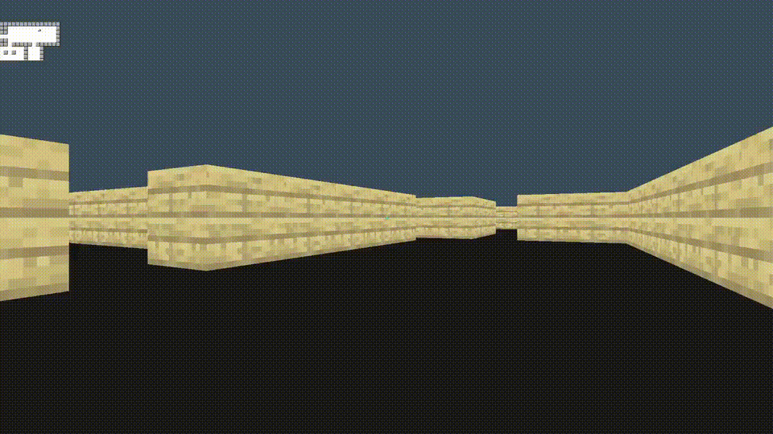

# cube3D

## Demo



## Features

- WASD movement
- Portal teleportation
- Sprint with Shift
- Mouse Y-axis movement
- Jumping

### structure file
```
-include/
|----cube.h
|----module.h
-lib/
-srcs/
|----main/
|   |----cube.c
|----module/
    |----module_internal.h
    |----module.c
    |----sub_module/
        |----submodule_internal.h
        |----file.c
Makefile
flake.nix
flake.lock
```
